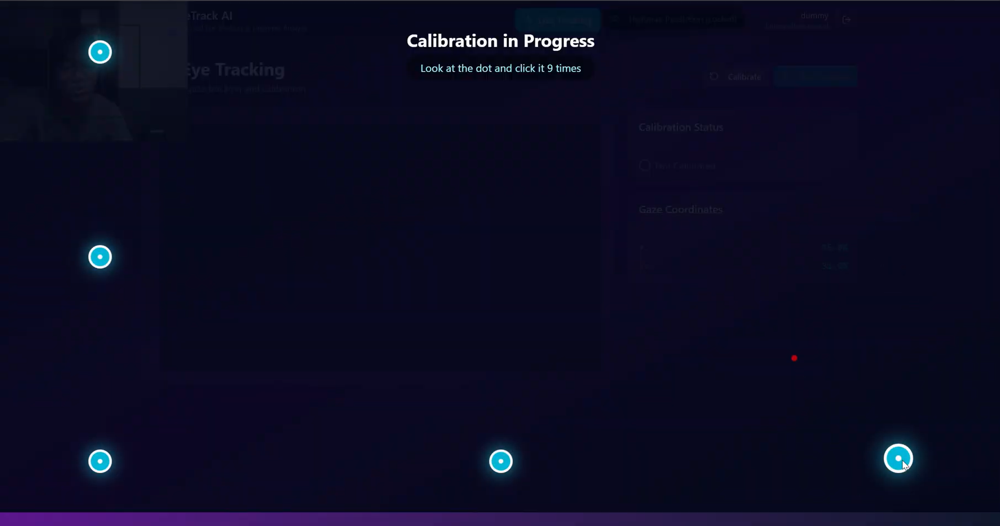

# EyeTrack AI — EyGaze Heatmap

Aplikasi web untuk **eye tracking berbasis webcam** dan **pembuatan heatmap pandangan mata (gaze heatmap)**. Pengguna melakukan kalibrasi, merekam titik pandangan secara langsung (live tracking), lalu aplikasi menghasilkan heatmap yang ditumpuk di atas gambar/layar yang diamati.

Proyek ini dibuat sebagai alat pendukung penelitian eye tracking bersama dosen pembimbing.


*Layar kalibrasi: pengguna menatap dan mengklik tiap titik (9 titik) agar model pelacak pandangan sesuai dengan mata dan posisi layar pengguna.*

---

## Fitur Utama

- **Kalibrasi 9 titik** — pengguna menatap dan mengklik titik-titik di layar untuk melatih pelacak pandangan, dengan indikator status kalibrasi.
- **Live Tracking** — koordinat pandangan (X, Y) ditampilkan secara real-time dari webcam.
- **Heatmap Prediction** — titik-titik pandangan diubah menjadi heatmap (kernel Gaussian, colormap *turbo*) dan ditumpuk pada gambar latar yang dipilih.
- **Manajemen gambar latar (model)** — unggah, lihat, dan hapus gambar yang dijadikan dasar heatmap.
- **Riwayat sesi** — heatmap tersimpan per pengguna dan dapat dilihat kembali atau dihapus.
- **Autentikasi dan peran** — login berbasis JWT dengan dua peran: pengguna biasa dan admin.
- **Panel admin** — ringkasan jumlah pengguna, heatmap, dan gambar latar, daftar pengguna dan sesi, serta penampil log server.
- **Pembatasan laju (rate limiting)** — pembatasan permintaan API per IP/token, termasuk pembatasan ketat pada endpoint registrasi.

## Cara Kerja Singkat

1. Pengguna login lalu membuka halaman **Live Tracking**.
2. Browser mengakses webcam dan [WebGazer.js](https://webgazer.cs.brown.edu/) memperkirakan titik pandangan setelah kalibrasi.
3. Titik pandangan (x, y) beserta ukuran layar dikirim ke backend FastAPI.
4. Backend membangun heatmap (NumPy + Matplotlib), menumpuknya pada gambar latar, dan menyimpannya per pengguna.
5. Hasil dapat dilihat di halaman **Heatmap Prediction**.

> Catatan: akses webcam di browser mengharuskan koneksi **HTTPS** (atau `localhost`).

## Tech Stack

| Bagian | Teknologi |
|--------|-----------|
| **Frontend** | React, TypeScript, Vite, Tailwind CSS, Material UI, Radix UI, React Router |
| **Eye tracking** | WebGazer.js |
| **Backend** | Python, FastAPI, Uvicorn |
| **Pengolahan data/gambar** | NumPy, Pandas, OpenCV (headless), Matplotlib |
| **Autentikasi** | JWT (PyJWT), hashing password dengan bcrypt/passlib |
| **Keamanan API** | SlowAPI (rate limiting), CORS middleware |
| **Database** | SQLite |
| **Deployment** | Docker, Docker Compose, Nginx |

## Struktur Proyek

```
EyGazeHeatmap_Frontend_V1/
├── backend/
│   ├── main.py                 # Endpoint API utama (auth, model, heatmap)
│   ├── admin.py                # Endpoint admin (dashboard, log)
│   ├── models.py               # Skema Pydantic
│   ├── services/               # Layanan autentikasi dan pembuat heatmap
│   ├── requirements.txt
│   └── Dockerfile
├── frontend/
│   ├── src/app/components/     # Login, LiveTracking, HeatmapPrediction, AdminPanel
│   ├── nginx.conf              # Reverse proxy untuk produksi
│   ├── vite.config.ts          # Konfigurasi Vite (proxy + HTTPS untuk dev)
│   └── Dockerfile
├── compose.yml / compose.prod.yml
├── .env.example
└── docs/images/                # Screenshot untuk dokumentasi
```

## Ringkasan Endpoint API

Dokumentasi interaktif (Swagger UI) tersedia di `http://localhost:8000/docs`.

| Method | Endpoint | Fungsi |
|--------|----------|--------|
| POST | `/api/login` | Login dan mendapatkan token JWT |
| POST | `/api/register` | Registrasi pengguna baru |
| GET | `/api/verify-token` | Validasi token |
| POST / GET / DELETE | `/api/model/...` | Unggah, ambil, dan hapus gambar latar |
| POST / GET / DELETE | `/api/heatmap/...` | Simpan, ambil, dan hapus heatmap per pengguna |
| GET | `/dashboard-data`, `/logs` | Data dan log khusus admin |

---

## Konfigurasi Environment

Salin `.env.example` menjadi `.env`, lalu isi nilainya. **Jangan pernah meng-commit file `.env`.**

| Variabel | Keterangan |
|----------|------------|
| `JWT_TOKEN` | Secret penandatangan JWT (string hex acak 32/64 karakter) |
| `ACCESS_TOKEN_EXPIRE_MINUTES` | Masa berlaku token (default 60) |
| `PUBLIC_IP` | IP publik saat deploy global; biarkan default untuk lokal |
| `DB_USER`, `DB_PASSWORD` | Kredensial akun admin awal yang dibuat saat aplikasi pertama kali berjalan |
| `HEATMAP_PATH`, `MODEL_PATH`, `LOG_PATH` | Lokasi penyimpanan heatmap, gambar latar, dan log |

> ⚠️ **Keamanan:** ganti `DB_USER`/`DB_PASSWORD` dan buat `JWT_TOKEN` baru yang acak sebelum deploy ke produksi.

---

## 1. Production Workflow (Docker)

Gunakan alur ini untuk membangun dan menjalankan aplikasi menggunakan Docker.

### Step 0: Clone repository
```bash
git clone https://github.com/Eyapa/EyGazeHeatmap_Frontend_V1
cd EyGazeHeatmap_Frontend_V1
```

### Step 1: Siapkan environment variables
File `.env` tidak ikut di-commit demi keamanan, jadi buat dari template:

```bash
cp .env.example .env
# Edit .env dan isi nilai rahasia (mis. JWT_TOKEN)
# Windows: buka dengan Notepad. Linux/WSL: gunakan nano.
nano .env
```

### Step 2: Build dan deploy
Proyek memakai `compose.yml` dasar dan override produksi `compose.prod.yml`. Gunakan keduanya agar pengaturan produksi berlaku.

```bash
docker compose -f compose.prod.yml build --no-cache
docker compose -f compose.prod.yml up -d
```

### Step 3: Verifikasi
- Frontend: `http://localhost:80` (atau domain Anda)
- Backend API: `http://localhost:8000/docs` (Swagger UI)

---

## 2. Development Workflow (Lokal)

Alur ini mendukung **Hot Reloading** dan memakai **Vite Proxy** untuk berkomunikasi dengan backend.

**Prasyarat:** Node.js v18+ dan Python 3.9+

### Step 1: Setup backend
```bash
git clone https://github.com/Eyapa/EyGazeHeatmap_Frontend_V1
cd EyGazeHeatmap_Frontend_V1/backend

python -m venv venv
# Windows:
.\venv\Scripts\activate
# Linux/Mac:
source venv/bin/activate

pip install -r requirements.txt
uvicorn main:app --reload --port 8000
# atau: python -m main
```

### Step 2: Setup frontend
Buka terminal baru:

```bash
cd frontend
npm install

# Gunakan konfigurasi Vite untuk development
mv vite.config.ts vite.config.prod.ts
cp vite.config.dev.ts vite.config.ts

npm run dev
```

Buka `https://localhost:3000` di browser.
*Terima peringatan sertifikat "Unsafe/Advanced" agar kamera dapat diakses (HTTPS diperlukan oleh WebGazer).*

---

## 3. Maintenance

### Reset environment
Jika muncul error "folder instead of file" pada `database.db`:

```bash
docker compose down
rm -rf backend/database.db   # hapus 'folder' database palsu bila ada
touch backend/database.db    # buat file kosong agar mount berhasil
docker compose -f compose.prod.yml up -d
```

### Catatan struktur
- `backend/db/` — lokasi yang disarankan untuk file SQLite (strategi `.gitkeep`)
- `frontend/nginx.conf` — logika reverse proxy untuk produksi
- `frontend/vite.config.ts` — proxy dan HTTPS untuk development

---

## Pengembangan dan Kredit

Dikembangkan oleh **Early Achiril Putra dan Arfa Naufal** sebagai alat pendukung penelitian eye tracking, di bawah bimbingan **Bagaskoro Saputro, S.Si., M.Cs.**, [BINUS University].

Teknologi pihak ketiga: [WebGazer.js](https://webgazer.cs.brown.edu/) untuk estimasi titik pandangan.
